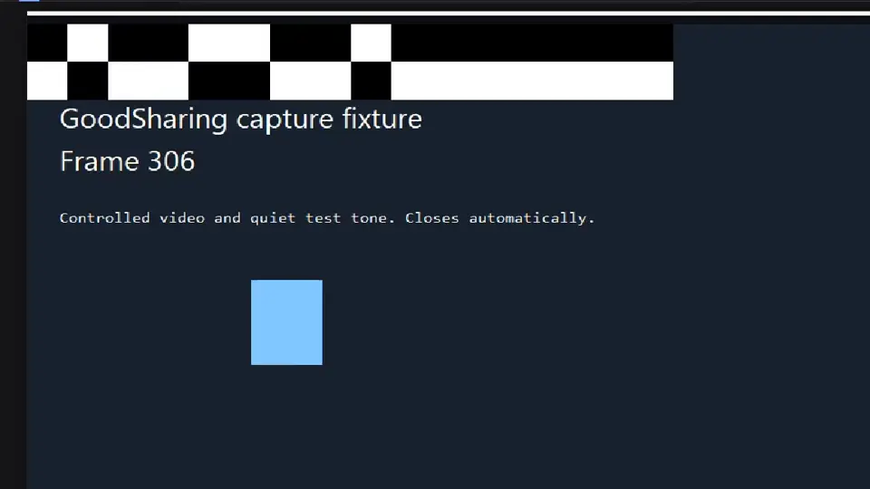

# GoodSharing

A Windows screen-sharing client: share a window or a whole display with audio, and watch someone else's, through a **self-hosted LiveKit SFU** with end-to-end encryption. No peer-to-peer, no third-party service, no account system — a server you own and two clients.



## Why it exists

Discord and OBS are either closed-source, require an account, or are built for streaming rather than one-to-one screen sharing. GoodSharing is a small, auditable alternative: capture with Windows Graphics Capture, encode with the hardware H.264 encoder, publish over WebRTC, and present with Qt Quick.

## Features

- **Share** a window or a display, with audio off / one application / desktop audio
- **Watch** at 720p or 1080p, click a person to switch to their screen while still sharing your own
- **Three latency profiles**: Low latency (70 ms buffer), Balanced (150 ms), Smooth (300 ms)
- **30 or 60 fps**, hardware CBR encoding, two published tracks (1080p + 720p)
- **E2EE** — one shared 64-hex key; a wrong key yields no picture, verified by test
- **People panel** — per-person volume slider, stop watching, live "sharing" state
- **Self-preview** toggle, floating share pill with the shared source name
- **Portable** — a folder you can copy; settings live in `GoodSharing.ini` next to the exe
- Optional **per-user installer** with a clean uninstaller

## Architecture

```
 capture           encode                publish            transport
 ───────           ──────                ───────            ─────────
 Windows Graphics  Media Foundation      SharePublisher     LiveKit SFU
 Capture (WGC)  →  H.264 CBR (2 tracks) → (E2EE, GCM)   →  (self-hosted)
 WASAPI audio      NV12 → H.264            audio pacing

 transport           receive              present
 ─────────           ───────              ───────
 LiveKit SFU      →  RemoteShare       →  RemoteVideo  → VideoItem (Qt Quick)
                     RemoteAudioPlayout →  WASAPI sink → speakers
```

Key design points:

- **Capture and publish are independent of join/subscribe/playback.** The test harness drives both ends through the same binaries rather than mocks.
- **Presentation is scheduled against a shared A/V timeline**: audio and video are both stamped from the sender's capture clock and presented with a configurable lead, so a late frame is dropped rather than shown desynchronised.
- **The encoder degrades instead of the queue growing**: raw frames are rate-limited and replaced, never buffered without bound.

## Building

Requirements: Windows 10/11, Visual Studio 2022 (MSVC), CMake, Qt 6.8.3 (MSVC 2022 64-bit), and the patched LiveKit C++ SDK + server used by the tests.

```powershell
./scripts/build.ps1            # configure + build
./scripts/package.ps1          # produce packaging/dist/GoodSharing-*-win64
./scripts/install.ps1          # optional per-user install
```

Vendored toolchains (`.deps/`, `.tools/`) are fetched by the build scripts and are not committed.

## Testing

The repository ships a measurement harness that runs real capture, real encoding, a real SFU and real playback, then asserts on measured values rather than "it looked fine":

```powershell
python scripts/test_remote_av.py --case 720 --share-fps 30
python scripts/test_remote_av.py --case 1080 --share-fps 60 --profile smooth
python scripts/test_remote_av.py --case 720 --server-url ws://<sfu>:7880   # over the internet
```

Each run writes `summary.json` with frames submitted/admitted/drawn, paint times, audio gaps and coverage, A/V lag bounds, per-process CPU, and machine load:

| Metric | Meaning |
| --- | --- |
| `drawn_distinct_frames` | pictures actually presented |
| `longest_quiet_ms` | longest audio silence inside committed playback |
| `estimated_media_window_coverage` | fraction of the session audio was actually playing |
| `system_cpu` / `footprint` | machine load and per-process cost during the run |

## Status and limitations

Working and tested end to end: sharing, watching, audio, E2EE, multi-share, 720p/1080p at 30/60 fps, portable packaging, and a two-machine session over the internet.

Known limitations, in priority order:

1. **Packet loss cannot be buffered away** (docs/70): at 10% loss every profile fails with the same coverage, so the next lever is FEC/retransmission.
2. **Video flicker under packet loss** on Wi-Fi: frames arrive in 150–200 ms clumps; the client freezes the last picture instead of blanking, but recovery depends on keyframes rather than per-packet repair.
3. **CPU presentation** (`QQuickPaintedItem`) caps 1080p60 at roughly 50–56 fps presented.
4. **Not code-signed**, so SmartScreen warns on first run.
5. **Token issuance is manual** — room tokens are minted out of band; a production deployment needs an auth service and per-room key distribution.

## A few words from me

I am not a professional developer. I built this because I could not find a simple way to show my screen to someone without giving an account to a company, and because I wanted to learn how this stuff actually works.

It took a lot of time. Most of it was not writing features, it was finding out why the sound stopped after ten seconds, why the window disappeared, why the picture flickered when the internet hiccuped. Every time something broke I tried to understand it properly instead of hiding it, and that is what most of the `docs/` folder is.

It is not finished and I know exactly where it is not finished (see the list above). The server is one I rent and configured myself, the code is written by me with the help of an AI assistant, and it works between my desktop and an old laptop.

If you look at this project for a job: the interesting part is not that it shares video, it is the documentation of the failures and how each one was traced down.

## Documentation

The `docs/` folder contains the engineering log: capture and encoding decisions, the A/V scheduling model, the crash postmortems, remote SFU deployment, and the measurement methodology. `docs/69-crash-synthetic-tickets.md` is a good example of the debugging standard used throughout — every claim backed by a measurement.

## License

MIT — see [LICENSE](LICENSE). Third-party components and their licenses are listed in [THIRD-PARTY-NOTICES.txt](THIRD-PARTY-NOTICES.txt).
