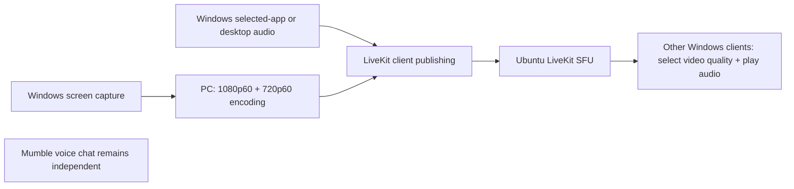

# Product and architecture

Status: target architecture with partial local implementation. Capture/preview and the separate hardware/encrypted-media harness exist; integrated room sharing/playback remains planned. See [current evidence](08-local-implementation-results.md), [the next integration phase](10-next-local-integration-plan.md), and [the execution boundary](../PLAN.md#execution-boundary).

## Product scope

The first release is a separate screen-sharing app. People keep talking through Mumble. Shared application/game audio is part of a screen share; it is not microphone voice chat.

The initial target is a small private group with up to three simultaneous sharers. Viewer capacity beyond that is a measured result, not a promised fixed limit. Each client may publish its own share while receiving other shares.

Low CPU and memory use is a primary requirement (confirmed 2026-10-20), together with low latency. Prefer hardware encode/decode, GPU scaling/rendering with few copies, reusable buffers, bounded queues and notification-driven idle workers. A normal viewer decodes only its selected quality per share. Do not keep encoders/readers/capture running after their share stops. Current capture uses CPU readback and the synthetic receiver reports software decoding; those paths are not a completed GPU pipeline. Record CPU core equivalents and whole-machine percentage, private committed memory and resident working set separately for idle, sharing, viewing and simultaneous use. The finished client needs measured budgets on target hardware; no arbitrary RAM/CPU guarantee is implied yet.

Defer microphone chat, Mumble plugins, game overlays, recording, remote control, accounts with complex roles, public room discovery, and automatic updates. Keep the client and service interfaces extensible without building unused subsystems.

## User flow

1. Open the app and join the configured private room.
2. See available shares and connection status.
3. Select Share, then select a window or monitor.
4. Select audio: selected application, desktop, or off. Monitor capture with application audio requires choosing an audio application separately.
5. Confirm Start. Show a persistent sharing indicator and a direct Stop control.
6. Watch other shares in tiles; choose Auto, 1080p, or 720p, adjust per-share audio, and enlarge a tile.
7. Stopping a share stops its video and shared audio together and leaves room membership intact.

Use a compact window, neutral dark theme, readable labels, visible keyboard focus, and a grid of up to three share tiles. Put primary actions in a small bottom bar. Handle Windows display scaling and resizing. Show plain-language errors with a useful next action. Do not expose SDK/codec jargon in the normal sharing flow.

## Components

| Component | Proposed implementation | Responsibility |
| --- | --- | --- |
| Desktop UI | Qt Quick/QML | Room view, source selection, previews, share controls, per-share quality/volume. |
| Client controller | C++20 | Lifecycle, settings, worker coordination, bounded queues, error reporting. |
| Video capture | Windows Graphics Capture + D3D11 | Obtain selected display/window frames through Windows. |
| Audio capture | WASAPI loopback | Selected process tree or desktop mix, with an explicit user selection. |
| Encoding/transport | Pinned LiveKit C++ SDK and supported Windows hardware path | Publish media and react to network feedback. |
| Rendering/playback | GPU-backed Qt integration and a bounded audio output pipeline | Decode/display received video and play shared audio. |
| Media server | Self-hosted LiveKit SFU on Ubuntu | Forward media; no server video transcoding. |
| Small control service | Proposed Go service using LiveKit's server SDK | Private-room access, short-lived participant tokens, health endpoint. |
| Public endpoint | TLS reverse proxy on TCP 8765 | Route control requests and LiveKit signaling; media uses the separately configured UDP path. |

Server language is a routine implementation choice; C++ is for the Windows client, not a requirement to rewrite the existing SFU. Keep the control service small and use an existing token-signing library.

## Media topology

Use one logical share identifier to associate video qualities, one shared-audio track, owner identity, and lifecycle. Publish audio once per share, rather than duplicating it for each video quality. A viewer subscribes to one video quality per share at a time, plus its audio when enabled.

The sending PC normally uploads approximately 6 Mbps + 3 Mbps of video at the initial benchmark settings, plus shared audio and transport overhead. These are starting settings, not a quality guarantee for every game. Hardware encoders must support the required concurrent workload. Receiving three 1080p shares is approximately 18 Mbps of video per viewer at those settings. Test different bitrates using readable text and high-motion footage.

## Exact quality publication: validate before selecting a path

Preferred: one logical LiveKit video publication with genuine 1080p/720p simulcast, both at 60 FPS, using a verified hardware encoder path. Prove configurable layer dimensions, frame rates, subscription selection, and encoder identity in the pinned C++ SDK.

Do not assume that enabling SDK simulcast produces our desired layer sizes. Also, pre-encoded publishing does not turn one H.264 access unit into two resolutions: LiveKit documents a single spatial layer for a pre-encoded source.

The selected feasibility path is **two explicitly paired video publications**, one for each quality, encoded locally and to be grouped as one share in our UI. The synthetic harness has validated exact dimensions, hardware encoding, and sustained decoding; integrated app quality selection, CPU/bandwidth under concurrent use, keyframe switching, and cleanup remain to be validated. Normal subscribers select one quality. Describe this as paired tracks, not genuine simulcast. Never silently substitute server transcoding or a 30 FPS layer.

External hardware encoding needs adaptation to requested bitrate and keyframe feedback. Keep capture, encoder, and publisher boundaries separate so this can be implemented without changing the UI model. Avoid holding capture locks while making SDK calls.

## Future voice boundary

Keep screen-share audio identified as screen-share audio and separate from any future microphone track. Reserve room-controller interfaces for optional microphone publication, output routing, and mute/deafen. Implement no microphone capture, voice activation, voice DSP, or Mumble bridge in this release.

Future voice must not require replacing the screen-share capture or transport design. It still needs its own product decision and tests against Mumble; current screen/video benchmarks do not establish voice quality.

## Sources

- [Qt Quick](https://doc.qt.io/qt-6/qtquick-index.html)
- [LiveKit C++ quickstart](https://docs.livekit.io/transport/sdk-platforms/cpp/)
- [LiveKit SFU](https://docs.livekit.io/reference/internals/livekit-sfu/)
- [Pre-encoded publishing and its single-layer limitation](https://docs.livekit.io/transport/media/pre-encoded/)
